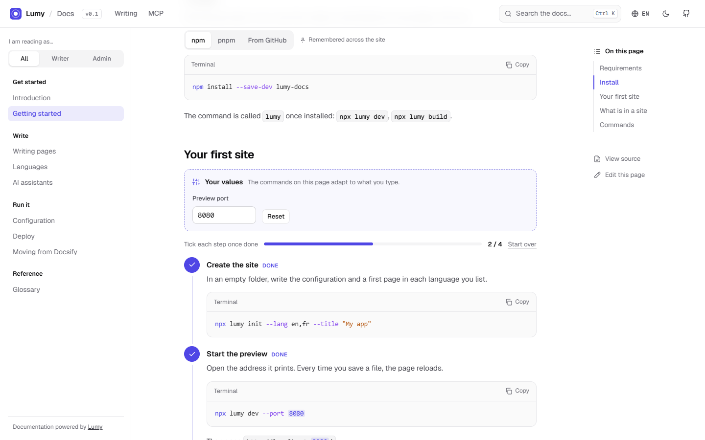

<p align="center">
  
</p>

<h1 align="center">Lumy</h1>

<p align="center">Light, multilingual, interactive documentation. Write Markdown, get a fast static site.</p>

<p align="center"><strong>English</strong> · <a href="README.fr.md">Français</a></p>

<p align="center">
  
</p>

---

Lumy turns a folder of Markdown files into a documentation site that loads at once, reads well on a phone, speaks several languages, and helps readers do what the page describes.

- **Light.** Plain HTML built ahead of time, one stylesheet, one small script. No framework in the browser, nothing from a third-party CDN, one dependency at build time.
- **Easy to change.** Pages are Markdown; navigation, languages and colours live in `lumy.config.json`.
- **Multilingual.** One folder per language. Readers land in their language and keep their place when they switch; untranslated pages fall back to the source language, and translations that fell behind their source are flagged.
- **Interactive.** Blocks that make readers act: steps to tick, tabs remembered site-wide, the reader's own values inside commands, annotated screenshots, quizzes, a glossary on hover, search with typo tolerance (Ctrl K).
- **Open to AI.** `lumy mcp` lets Claude, or any MCP client, read and write the docs; every site publishes `llms.txt` and each page as Markdown.
- **A server when you want one.** `lumy serve` adds a dashboard, accounts and private documentation, reader feedback, an assistant that answers from the docs (Ollama, OpenAI, Anthropic, Google, OpenRouter, fal.ai, Mistral, Groq or any OpenAI-compatible server), and a remote MCP server. One Docker image.
- **Smooth.** Every interaction animates, and all motion stops for readers who ask their system for less.
- **No account to read. Ever.**

## Quick start

```bash
npm install --save-dev lumy-docs     # or: npm install --save-dev github:PetitOursManu/Lumy
npx lumy init --lang en,fr --title "My app"
npx lumy dev
```

Then edit `docs/en/index.md`. `npx lumy build` writes the site to `dist/`.

## A page

```md
---
title: Install
description: Get it running in five minutes.
---

:::vars
port = 8080 | Port
:::

:::steps id=install
1. **Start the container.**
   ```bash
   docker run -p {{port}}:8080 my-app
   ```
2. **Open it.** Go to `http://localhost:{{port}}`.
:::

:::why Why port 8080?
Because ports below 1024 need extra rights on most systems.
:::
```

Every block is described, with a live example, in the documentation: [`site/docs/en/writing.md`](site/docs/en/writing.md).

## Commands

| Command | What it does |
|---|---|
| `lumy init [folder]` | Creates a site |
| `lumy dev` | Preview with live reload |
| `lumy build` | Writes the static site to `dist/` |
| `lumy serve` | Serves the site with its dashboard, assistant and MCP server |
| `lumy check` | Reports broken links, missing images, unknown blocks, outdated translations |
| `lumy translations [--stamp]` | Translation status; `--stamp` marks translations current |
| `lumy mcp` | MCP server for AI assistants (stdio) |
| `lumy import docsify <folder>` | Converts a Docsify site |

## Docker

```bash
cp docker-compose.example.yml /path/to/your/docs/docker-compose.yml
cd /path/to/your/docs && docker compose up -d
```

Then open `http://localhost:4000/_lumy/setup` to create the administrator account.

## Sign in with Kosmy Board

[Kosmy Board](https://github.com/PetitOursManu/Kosmy-Board) gathers the admin pages of your self-hosted apps and signs you in to them. `lumy serve` accepts it as an OpenID Connect provider:

1. In Kosmy Board, add the Lumy instance (its address, with the base path if any, such as `https://example.com/docs`), then **Edit → Single sign-on** and turn it on. The redirect URI `{instance}/auth/kosmy-board/callback` and the initiate login URI `{instance}/auth/kosmy-board/login` are filled in for you.
2. In Lumy's dashboard, **Access → Kosmy Board**: paste the issuer, the client ID and the client secret. The secret is encrypted on the server and never shown again.
3. Each person who should get in links their own account once, under **Account → Link to Kosmy Board**.

From then on, **Sign in with Kosmy Board** on the sign-in page, or **Open** in Kosmy Board, opens that person's Lumy account with its role. Accounts are matched on the Kosmy Board `sub` only, never on the email (Kosmy Board does not verify it): a Kosmy Board account that nobody linked opens nothing, and no one gets the administrator role through Kosmy Board unless an administrator linked their own account. The flow uses `state`, `nonce` and PKCE (S256), `client_secret_basic`, and checks the ID token's RS256 signature, `iss`, `aud`, `exp` and `nonce`, with no added dependency.

### Admin in Kosmy Board

Once sign-in with Kosmy Board is set up, an administrator can also run Lumy's dashboard **from Kosmy Board**, with its **Admin** button, without opening Lumy: the overview (pages, translations, reader feedback, last build and its warnings, rebuild), reader feedback per page and comments, the assistant (on/off, provider, address, model, API key, test), access (who can read, sign-ups, reader feedback, the Kosmy Board connection), accounts (add, change role, set a password, unlink from Kosmy Board, remove), MCP (switches, address, access tokens) and your own password.

Kosmy Board's server calls `{instance}/api/kosmy-board/admin` with a 60-second token signed by its OpenID Connect key, made for one request and used once. Lumy checks it (RS256, `typ`, `iss`, `aud`, `exp`, `htm`, `htu`, `jti`), then opens only the Lumy account **linked** to that Kosmy Board account, under Account, and only if it is an **administrator**: Kosmy Board gives no rights. Every action goes through the same checks as the dashboard, and saved secrets (API keys, client secret) are never sent back; a new MCP token is shown once. Uploading files and editing pages stay in Lumy and in the documentation's source. The protocol: [kosmy.board-admin.v1](https://github.com/PetitOursManu/Kosmy-Board/blob/main/docs/admin-api.md).

### Users managed by Kosmy Board

Kosmy Board can also manage who gets into Lumy ([kosmy.board-users.v1](https://github.com/PetitOursManu/Kosmy-Board/blob/main/docs/users-api.md)): an administrator of the Board gives a person access to the Lumy instance with a role (**Administrator**, **Editor** or **Reader**) and, for editors, one restriction, **Can use MCP access tokens** (off: the editor cannot create tokens and their tokens stop working). Kosmy Board's server calls `{instance}/api/kosmy-board/users` (GET), and `{instance}/api/kosmy-board/users/{sub}` (PUT, DELETE), with the same one-request token as the admin; the person who acts must open an active Lumy administrator.

- **PUT** creates the account, linked to that Kosmy Board account and **without a password** (it signs in with Kosmy Board), or links an unlinked account that carries the same email, or updates the linked one: role, restriction, name and email shown. An email already linked to another Kosmy Board account is refused (409).
- **DELETE** **disables** the account, and its data stays: its sessions end, and it can no longer sign in with its password or with Kosmy Board, use the admin in Kosmy Board, or use its MCP tokens. A later PUT enables it again.
- Nobody can take away their own administrator rights or access from the Board, and the site always keeps one active administrator (409).
- At sign-in, when the ID token carries `kosmy_board_access`, Lumy applies it like a PUT and creates the account if needed (never linking by email there); without it, nothing changes: an unlinked `sub` still opens nothing.

## Documentation

Lumy's documentation is written with Lumy, in English and French, in [`site/`](site/):

```bash
npm run dev        # then open http://localhost:4000
```

## Development

```bash
npm install
npm test               # node:test, no other tool
npm run dev        # Lumy's own docs, with live reload
```

The code is small on purpose: `src/` holds the build (Markdown, pages, search, languages, MCP) and the server (accounts, assistant, dashboard API), `theme/` the reader-side stylesheet and script, and `theme/admin/` the dashboard. `maquette/` keeps the first mock-up the design came from.

## Licence

MIT. The Geist fonts in `theme/fonts/` are under the SIL Open Font License (`theme/fonts/OFL.txt`).
